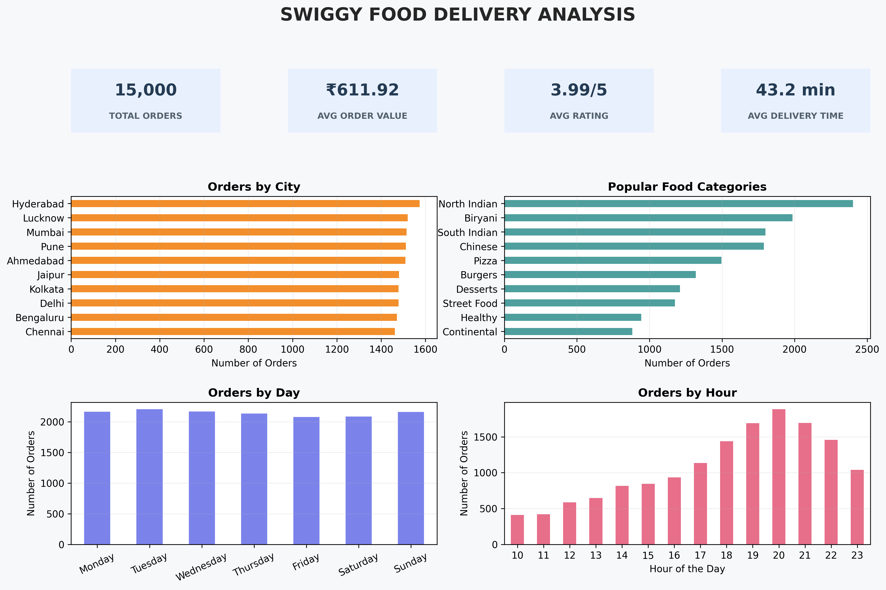

# swiggy-data-analysis
python-based analysis of Swiggy food delivery data using Pandas, NumPy, Matplotlib and Seaborn.
# Swiggy Food Delivery Data Analysis

## Project Overview
This project analyses Swiggy food delivery data using Python. The main purpose is to understand customer ordering patterns, restaurant performance, delivery times and customer satisfaction.
## dataset used
      https://drive.google.com/drive/folders/1AUY9sLghThqXSTvC9bvNjjozNHNdKhFo

## Tools and Technologies
- Python
- Pandas
- NumPy
- Matplotlib
- Seaborn
- Google Colab

## Project Objectives
1. Understand overall order and customer patterns.
2. Understand relationships between customer orders and delivery performance.
3. Compare business performance across different groups.
4. Understand ordering trends and suggest improvements.

## Key Performance Indicators
- Total Orders: 15,000
- Average Order Value: ₹611.92
- Average Customer Rating: 3.99/5
- Average Delivery Time: 43.2 minutes

## Key Findings
- Order value and delivery time showed almost no linear correlation (0.001).
- Delivery time and customer ratings showed a negative correlation (-0.389).
- City-wise, category-wise and time-based comparisons were performed to understand business patterns.

## Dashboard

## Project Files
- Jupyter Notebook: Contains the complete Python analysis.
- Dashboard: Visual representation of important findings.
- Dataset: CSV file used for analysis.

## Conclusion
This project helped me practise data cleaning, exploratory data analysis, data visualisation and interpreting business data using Python. The analysis provides useful insights into customer behaviour and delivery performance.

## Author
Created as a beginner-level data analytics project.
